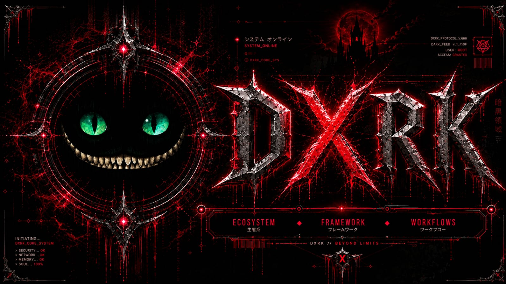

# Dxrk

### El motor open-source de automatización y generación multimedia para agentes de IA



[](https://github.com/Dxrk777/Dxrk/releases/latest)
[](https://www.python.org/downloads/)
[](https://github.com/Dxrk777/Dxrk/actions/workflows/ci.yml)
[](https://github.com/Dxrk777/Dxrk/actions/workflows/ci.yml)
[](https://github.com/Dxrk777/Dxrk/actions/workflows/ci.yml)
[](LICENSE)
[](docs/platforms.md)

**Dxrk** combina un orquestador local-first para **14 agentes de IA** con **Dxrk Omni**, un pipeline multimedia que convierte un tema en un short vertical o en una producción long-form por capítulos. Python 3.14+, 100% de cobertura, CI verde en Linux, macOS y Windows.

> **Estado actual:** `v1.5.0` · Python `3.14+` · 7.406 tests · 100% coverage · MIT · sin dependencia de servicios cloud para el núcleo.

---

## Tabla de contenidos

- [Qué es Dxrk](#qué-es-dxrk)
- [Características principales](#características-principales)
  - [Dxrk Omni: video engine](#dxrk-omni-video-engine)
  - [Backends visuales con fallback](#backends-visuales-con-fallback)
  - [Audio, música y subtítulos karaoke](#audio-música-y-subtítulos-karaoke)
  - [Arquitectura de agentes](#arquitectura-de-agentes)
  - [DxrkMemory 2.0](#dxrkmemory-20)
  - [Calidad de ingeniería](#calidad-de-ingeniería)
- [Instalación y requisitos](#instalación-y-requisitos)
- [Guía de uso rápido (CLI)](#guía-de-uso-rápido-cli)
- [Estructura del repositorio](#estructura-del-repositorio)
- [Estado de calidad y tests](#estado-de-calidad-y-tests)
- [Documentación](#documentación)
- [FAQ](#faq)
- [Roadmap](#roadmap)
- [Contribución](#contribución)
- [Licencia](#licencia)

---

## Qué es Dxrk

Dxrk es un proyecto open-source con dos capas que comparten el mismo principio: **automatizar trabajo real sin esconder la complejidad detrás de una caja negra**.

| Capa | Qué resuelve |
| --- | --- |
| **Agent Ecosystem** | Instala, configura y sincroniza 14 agentes de IA, memoria persistente, skills curadas, servidores MCP, workflows SDD, hooks, permisos y automatización Git. |
| **Dxrk Omni** | Convierte un tema en un video publicable: guion, imágenes, narración, subtítulos palabra por palabra, música y montaje final con FFmpeg. |

El núcleo es **local-first**: DxrkMemory 2.0 es 100% Python stdlib-only y Omni funciona con backends locales y fallbacks deterministas. Los servicios externos —LLM, ComfyUI, SD WebUI, Pollinations, MusicGen, Stable Audio— son opcionales y se activan explícitamente.

### El pipeline de Omni

```text
tema
  └─> guion (LLM opcional, fallback determinista)
      └─> imágenes (ComfyUI / SD WebUI / locales / placeholder)
          └─> narración (Edge-TTS) + word timings (Whisper / proporcional)
              └─> música (FFmpeg synth / MusicGen / Stable Audio / track propio)
                  └─> montaje FFmpeg
                      └─> final.mp4 (1080x1920, 30 fps, H.264/AAC)
```

Cada etapa escribe sus artefactos en `outputs/<slug>-<timestamp>/`, así que un fallo se puede inspeccionar o reanudar sin regenerar todo. El `manifest.json` registra tiempos, fuentes de imagen, errores y motivos de fallback.

---

## Características principales

### Dxrk Omni: video engine

- **Short-form listo para Shorts/Reels:** 1080x1920, 30 fps, H.264/AAC. Por defecto 30 segundos y 5 escenas; `--duration` acepta 5–180 y `--scenes` acepta 2–12.
- **Long-form por capítulos:** `--longform` genera un plan de capítulos y shots, narración y word timings por capítulo, offsets globales de subtítulos, una sola cama musical para toda la duración y concatenación final.
- **Modo determinista:** `--no-llm --image-source placeholder --no-music --subtitle-source proportional` produce un video reproducible sin LLM, sin red y sin modelos generativos.
- **Guion con LLM opcional:** endpoint compatible con OpenAI (Ollama por defecto en `http://127.0.0.1:11434/v1`). Si el LLM no está disponible o devuelve JSON inválido, se usa un plan determinista.
- **Artefactos inspeccionables:** `script.json`, `plan.json`, `manifest.json`, imágenes, clips, narración, `words.json`, `subtitles.ass`, música y `final.mp4`.
- **Aislado del paquete principal:** el pipeline vive en `scripts/`, no dentro de `dxrk/`. Tiene sus propios tests (`tests/test_omni_script.py`, `tests/test_omni_advanced.py`) y no debilita el contrato de cobertura del core.

### Backends visuales con fallback

- **ComfyUI local:** `--image-source comfyui` envía un workflow a `POST /prompt`, sigue el progreso por `/ws?clientId=...` cuando `websockets` está instalado y cae a `GET /history/{prompt_id}`. El resultado se obtiene de `GET /view` y se recorta a 1080x1920.
- **Workflow propio:** `--comfy-workflow path.json` acepta placeholders `{{PROMPT}}`, `{{NEGATIVE_PROMPT}}`, `{{SEED}}`, `{{WIDTH}}`, `{{HEIGHT}}` y `{{CHECKPOINT}}`.
- **Stable Diffusion WebUI:** `--image-source sdwebui` llama a `POST /sdapi/v1/txt2img` de AUTOMATIC1111 y decodifica la imagen en base64. El servidor debe arrancar con `--api`.
- **Imágenes locales:** `--image-source local --images-dir ./mi-carpeta` recorta tus imágenes al formato vertical.
- **Placeholders dinámicos:** si no hay backend disponible, Omni dibuja tarjetas con Pillow para que el pipeline nunca se detenga.
- **Fallback automático:** `--image-source auto` es el default. Prueba ComfyUI, luego SD WebUI, luego placeholder. Pollinations ya no está en la ruta automática; se usa solo con `--image-source pollinations`.

### Audio, música y subtítulos karaoke

- **Narración con Edge-TTS:** voz por defecto `es-AR-TomasNeural`. Edge-TTS emite eventos `WordBoundary` mientras transmite el audio.
- **Subtítulos word-level:** los timings se guardan en `assets/words.json` y se queman como ASS con `\kf` por palabra. Si la narración se acelera para entrar en la duración objetivo, los timings se escalan con el mismo factor de tempo.
- **Whisper opcional:** `--subtitle-source whisper` usa `faster-whisper` para obtener timestamps por palabra. No viene en el extra `omni`; se instala aparte con `uv pip install faster-whisper`.
- **Fallback proporcional:** `--subtitle-source proportional` distribuye las palabras por peso de caracteres sobre la duración del audio.
- **Música sintetizada:** `--music-source synth` (default) usa un sintetizador ambiental con FFmpeg, sin dependencias extra.
- **Música generativa:** `--music-source musicgen` (transformers + torch + scipy) o `--music-source stable-audio` (stable-audio-tools). Los modelos se cargan de forma lazy y la generación se hace por chunks con crossfades para superar el contexto de un solo modelo.
- **Track propio:** `--music ./assets/music/track` usa una pista de tu biblioteca.
- **Control total:** `--no-music` y `--no-subtitles` desactivan esas etapas sin romper el resto del pipeline.

### Arquitectura de agentes

- **14 adaptadores:** Claude Code, OpenCode, Kilo Code, Gemini CLI, Cursor, VS Code Copilot, Codex, Windsurf, Antigravity, Kimi Code, Kiro IDE, Qwen Code, Pi y OpenClaw.
- **MCP nativo:** cliente sobre stdio con JSON-RPC y **36 servidores** declarados en `.mcp.json`.
- **Automatización Git:** comandos `/commit`, `/branch` y `/pr`, generación de mensajes conventional commits y revisión con `dxrk review`.
- **Spec-Driven Development:** workflow `/sdd-init`, skills curadas, hooks, permisos por capability y registry de skills.
- **TUI Textual:** detección de agentes instalados, revisión de cambios y flujos interactivos.
- **Autonomía acotada y verificable:** el loop histórico `self-update / self-verify / self-learn` fue removido deliberadamente. `dxrk/autonomy` conserva el vocabulario de capabilities y la verificación vive en `dxrk/judge` como juez externo observe-only, con auto-fix desactivado por defecto. Los loops que existen son controlados y observables —scheduler de swarm, juez continuo y consolidación `sleep`— y ninguno muta el repositorio sin verificación.

### DxrkMemory 2.0

Memoria persistente local-first, **100% Python stdlib-only** (sin `chromadb`, sin `onnx`, sin `numpy`):

- `sqlite3` con FTS5 `trigram → porter → unicode61` y BM25 híbrido.
- Grafo temporal con `valid_from` / `valid_to` y consultas `as_of`.
- Dialecto AAAK con `compress` / `decode`.
- Layers de wake-up de 600–900 tokens (L0 + L1).
- Malla de locks en `~/.dxrk/locks` con reaping de locks huérfanos.
- 42 módulos Python y API pública `AgentMemory`, `Malla`, `KnowledgeGraph`.

### Calidad de ingeniería

- **Python 3.14+** con `ruff` target `py314` y `mypy` `python_version = 3.14`.
- **100% de cobertura** con branch coverage y `--cov-fail-under=100`.
- **CI matrix** Linux, macOS y Windows sobre Python 3.14.
- **Controles de supply chain:** `uv audit`, `uv build`, CodeQL y Scorecard.
- **Sin secretos en el repo:** configuración por `.env` y variables de entorno.

---

## Instalación y requisitos

### Requisitos

| Requisito | Versión / nota |
| --- | --- |
| Python | `>=3.14` (CI usa 3.14; el proyecto se desarrolla y prueba sobre la rama 3.14) |
| uv | Última versión estable |
| FFmpeg | `ffmpeg` y `ffprobe` disponibles en `PATH` |
| ComfyUI | Opcional, para `--image-source comfyui` |
| SD WebUI | Opcional, para `--image-source sdwebui` (AUTOMATIC1111 con `--api`) |
| Whisper | Opcional, `faster-whisper` para subtítulos word-level |
| MusicGen / Stable Audio | Opcional, con sus dependencias y modelos |

### Desde el código fuente

```bash
git clone https://github.com/Dxrk777/Dxrk.git
cd Dxrk
uv sync --all-extras --dev
```

Ese comando instala el core, el extra `omni`, las dependencias de desarrollo, typecheck, benchmarks y el tooling de documentación.

Si solo te interesa el pipeline multimedia:

```bash
uv sync --extra omni
```

### Instalación como herramienta

Dxrk no se publica en PyPI por diseño. Se instala directo desde GitHub:

```bash
uv tool install git+https://github.com/Dxrk777/Dxrk.git
```

### Verificación

```bash
uv run dxrk-py --help
uv run python scripts/omni.py --help
ffmpeg -version
```

---

## Guía de uso rápido (CLI)

### 1. Short vertical (modo corto)

```bash
uv run python scripts/omni.py "el futuro de la IA en Tokio"
```

El resultado queda en `outputs/<slug>-<timestamp>/final.mp4`.

Variante offline y determinista, sin LLM, sin música y con subtítulos proporcionales:

```bash
uv run python scripts/omni.py "el futuro de la IA en Tokio" \
  --no-llm \
  --image-source placeholder \
  --no-music \
  --subtitle-source proportional
```

Smoke test de 10 segundos:

```bash
uv run python scripts/omni.py "prueba" \
  --duration 10 --scenes 2 --image-source placeholder --no-llm
```

### 2. Backends visuales

ComfyUI local:

```bash
uv run python scripts/omni.py "mi tema" \
  --image-source comfyui \
  --comfyui-url http://127.0.0.1:8188 \
  --comfy-checkpoint sd_xl_base_1.0.safetensors
```

Stable Diffusion WebUI:

```bash
uv run python scripts/omni.py "mi tema" \
  --image-source sdwebui \
  --sdwebui-url http://127.0.0.1:7860
```

Imágenes propias:

```bash
uv run python scripts/omni.py "mi tema" \
  --image-source local --images-dir ./assets/mi-carpeta
```

Workflow de ComfyUI personalizado:

```bash
uv run python scripts/omni.py "mi tema" \
  --image-source comfyui \
  --comfy-workflow ./mi-workflow.json
```

### 3. Long-form por capítulos

```bash
uv run python scripts/omni.py "el futuro de la IA en Tokio" \
  --longform \
  --chapters 3 \
  --shots-per-chapter 3 \
  --chapter-duration 60
```

Cada capítulo dura al menos `--chapter-duration` segundos y crece si la narración es más larga. El plan se escribe en `plan.json`, los subtítulos se offsetean globalmente y se genera una sola cama musical para la duración total.

### 4. Música y subtítulos

MusicGen:

```bash
uv pip install transformers torch scipy
uv run python scripts/omni.py "mi tema" \
  --music-source musicgen \
  --music-model facebook/musicgen-small \
  --music-prompt "cinematic ambient score, no vocals"
```

Stable Audio Open:

```bash
uv pip install stable-audio-tools
uv run python scripts/omni.py "mi tema" \
  --music-source stable-audio \
  --music-model stabilityai/stable-audio-open-1.0
```

Whisper para word-level timestamps:

```bash
uv pip install faster-whisper
uv run python scripts/omni.py "mi tema" \
  --subtitle-source whisper --whisper-model small
```

Track propio:

```bash
uv run python scripts/omni.py "mi tema" --music ./assets/music/track
```

### 5. CLI del ecosistema de agentes

```bash
# Vista previa del setup de un agente
dxrk-py install --agent claude-code --preset full-dxrk --dry-run

# Indexar y consultar memoria local
python -m dxrk.memory mine ./mi-proyecto
python -m dxrk.memory search "arquitectura memoria"

# Sincronizar configuración
dxrk-py sync --agent claude-code --dry-run

# TUI
dxrk-py tui
```

### 6. Invocar Omni desde Python

El ejemplo [`examples/quick_omni_demo.py`](examples/quick_omni_demo.py) usa `OmniConfig` + `run_pipeline()` y se corre con:

```bash
uv run python examples/quick_omni_demo.py
```

La variante long-form está disponible con `--longform`. Ver [`examples/README.md`](examples/README.md).

### Flags principales de Omni

| Flag | Default | Propósito |
| --- | --- | --- |
| `--duration` | `30` | Duración objetivo del short (5–180 s) |
| `--scenes` | `5` | Cantidad de escenas (2–12) |
| `--image-source` | `auto` | `auto`, `comfyui`, `sdwebui`, `pollinations`, `local`, `placeholder` |
| `--subtitle-source` | `edge` | `edge`, `whisper`, `proportional` |
| `--music-source` | `synth` | `synth`, `musicgen`, `stable-audio`, `file` |
| `--longform` | off | Activa capítulos y shots |
| `--chapters` | `3` | Cantidad de capítulos (2–24) |
| `--shots-per-chapter` | `3` | Shots por capítulo (1–12) |
| `--chapter-duration` | `60` | Duración mínima por capítulo (15–600 s) |
| `--no-llm` | off | Guion y plan deterministas |
| `--seed` | `42` | Semilla de imágenes |
| `--output-dir` | `outputs` | Directorio raíz de salida |

La referencia completa de las 30+ opciones está en [`scripts/README.md`](scripts/README.md).

### Salida generada

```text
outputs/<slug>-<timestamp>/
├── final.mp4
├── manifest.json          # estado, timings, fuentes de imagen, errores
├── script.json            # guion short-form
├── plan.json              # plan long-form de capítulos y shots
└── assets/
    ├── scene_01.jpg
    ├── scene_01.mp4
    ├── narration.mp3
    ├── music.wav
    ├── audio.m4a
    ├── video.mp4
    ├── subtitles.ass
    ├── words.json         # timings word-level: text/start/end
    └── chapter_01/        # assets por capítulo en long-form
```

`outputs/` está ignorado por Git; los artefactos no se commitean.

---

## Estructura del repositorio

```text
Dxrk/
├── dxrk/                     # paquete principal
│   ├── agents/               # 14 adaptadores de agentes
│   ├── cli/                  # parsing, instalador, dry-run, run
│   ├── commands/             # /commit, /branch, /pr, review, mcp, memory...
│   ├── config/               # settings, perfiles, feature flags
│   ├── memory/               # DxrkMemory 2.0 (SQLite FTS5 + BM25 + Graph)
│   ├── mcp/                  # cliente MCP stdio JSON-RPC
│   ├── rag/                  # chunking, indexado y recuperación local
│   ├── security/             # RBAC, JWT, auditoría
│   ├── tui/                  # interfaz Textual
│   ├── utils/                # fileops, diff, hooks, http, image...
│   └── ...                   # enterprise, judge, observe, query, system...
├── scripts/
│   ├── omni.py               # entry point del pipeline multimedia
│   └── omni_media/
│       ├── images.py         # ComfyUI / SD WebUI / placeholders
│       ├── longform.py       # plan de capítulos y shots
│       ├── music.py          # synth / MusicGen / Stable Audio
│       └── words.py          # word timings / ASS karaoke
├── tests/                    # suite completa (7.406 tests)
├── outputs/                  # artefactos generados (gitignored)
├── docs/                     # documentación MkDocs
├── assets/                   # banner, iconos y recursos
├── benchmarks/               # benchmarks del proyecto
├── examples/                 # ejemplos de uso
├── pyproject.toml            # metadata, deps, ruff, mypy, coverage
├── uv.lock                   # lockfile (revision 5)
├── mkdocs.yml                # sitio de documentación
└── README.md
```

### Rutas clave

| Ruta | Qué contiene |
| --- | --- |
| `scripts/omni.py` | Pipeline completo: guion, imágenes, audio, música, subtítulos y montaje. |
| `scripts/omni_media/` | Backends y utilidades del pipeline, separados por responsabilidad. |
| `dxrk/agents/` | Adaptadores y registry de los 14 agentes soportados. |
| `dxrk/memory/` | DxrkMemory 2.0, memoria local stdlib-only. |
| `dxrk/commands/` | Comandos de agente y automatización Git. |
| `dxrk/mcp/` | Cliente MCP sobre stdio. |
| `tests/test_omni_*.py` | Tests del pipeline multimedia. |
| `outputs/` | Videos, imágenes y manifests generados. |
| `docs/omni.md` | Guía de Omni dentro del sitio de documentación. |

---

## Estado de calidad y tests

Gate local actual:

| Check | Resultado |
| --- | --- |
| Tests | **7.406 passed**, 1 skipped |
| Coverage | **100.00%** (branch coverage, fail-under 100) |
| Ruff | Limpio (`uvx ruff check dxrk tests`) |
| Mypy | **367 archivos**, sin errores |
| `uv audit` | Limpio |
| `uv build` | Wheel con `Requires-Python: >=3.14` |
| CI | Linux, macOS y Windows sobre Python 3.14 |

### Correr la suite completa

```bash
uv run python -m pytest
```

El `addopts` de `pyproject.toml` ya incluye `--cov=dxrk --cov-report=term-missing --cov-fail-under=100`.

### Correr solo los tests de Omni

```bash
uv run python -m pytest -q --no-cov \
  tests/test_omni_script.py tests/test_omni_advanced.py
```

### Otros gates

```bash
uvx ruff check dxrk tests
uv run mypy dxrk
uv audit
uv build
```

---

## Documentación

| Documento | Descripción |
| --- | --- |
| [docs/omni.md](docs/omni.md) | Guía de Dxrk Omni: short-form, long-form, backends, audio y subtítulos. |
| [scripts/README.md](scripts/README.md) | Referencia completa del pipeline y de todas las flags. |
| [examples/README.md](examples/README.md) | Ejemplos ejecutables, incluido el quickstart de Omni desde Python. |
| [docs/memory.md](docs/memory.md) | DxrkMemory 2.0: FTS5, BM25, grafo temporal, AAAK y layers. |
| [docs/architecture.md](docs/architecture.md) | Arquitectura del core y del pipeline Omni. |
| [docs/usage.md](docs/usage.md) | Guía de uso general de la CLI. |
| [docs/agents.md](docs/agents.md) | Adaptadores de agentes. |
| [docs/components.md](docs/components.md) | Componentes internos. |
| [docs/platforms.md](docs/platforms.md) | Plataformas soportadas. |
| [docs/config.md](docs/config.md) | Configuración y conmutador de modelos. |
| [docs/tenants.md](docs/tenants.md) | Multi-tenant local. |
| [docs/rbac.md](docs/rbac.md) | Roles y permisos. |
| [docs/roadmap.md](docs/roadmap.md) | Roadmap y decisiones históricas. |
| [CHANGELOG.md](CHANGELOG.md) | Historial de cambios. |
| [CONTRIBUTING.md](CONTRIBUTING.md) | Guía de contribución. |

---

## FAQ

**¿Necesito una GPU para usar Omni?**
No. El modo determinista con placeholders, FFmpeg synth, Edge-TTS y subtítulos proporcionales funciona en CPU. ComfyUI, SD WebUI, MusicGen y Stable Audio sí se benefician de una GPU.

**¿Necesito API keys?**
No para el flujo local-first. El LLM es opcional (Ollama por defecto), Pollinations se usa solo si lo pedís explícitamente y Edge-TTS requiere red para sintetizar la voz.

**¿Dónde quedan los videos?**
En `outputs/<slug>-<timestamp>/final.mp4`. El directorio está ignorado por Git.

**¿Funciona en Windows?**
Sí. La CI corre en Linux, macOS y Windows. Asegurate de tener `ffmpeg` y `ffprobe` en `PATH`.

**¿Dxrk está en PyPI?**
No. Se instala desde GitHub con `uv tool install git+https://github.com/Dxrk777/Dxrk.git`.

**¿Hay un loop autónomo de auto-actualización?**
No. El loop `self-update / self-verify / self-learn` fue removido. `dxrk/autonomy` conserva el vocabulario de capabilities y la verificación vive en `dxrk/judge` como juez externo observe-only. La autonomía se limita a workflows, hooks y permisos verificables.

**¿Cómo cambio de modelo?**
Editá `model.provider` en tu `config.yaml` o usá `dxrk-py model` (`list`, `current`, `set`). `dxrk-py sync` propaga la configuración a los agentes instalados.

---

## Roadmap

- **v1.0.0** — Multi-tenant y estabilización de API.
- **v1.2.0** — Endurecimiento de seguridad y CI verde en las tres plataformas.
- **v1.5.0 (actual)** — DxrkMemory híbrida local, lifecycle con episodios, sesiones durables, swarm honesto y **Dxrk Omni** con short-form, long-form, ComfyUI/SD WebUI, Edge-TTS/Whisper y música generativa.

---

## Contribución

Las contribuciones son bienvenidas. Antes de abrir un PR:

1. Leé [`CONTRIBUTING.md`](CONTRIBUTING.md) y [`CODE_OF_CONDUCT.md`](CODE_OF_CONDUCT.md).
2. Corré `uv sync --all-extras --dev`.
3. Asegurate de que pasen `uv run python -m pytest`, `uvx ruff check dxrk tests`, `uv run mypy dxrk` y `uv audit`.
4. Usá conventional commits y mantené los cambios atómicos.
5. No commitees `.env`, secretos, tokens ni claves privadas.

---

## Licencia

[MIT](LICENSE)

---

**DXRK // BEYOND LIMITS**
