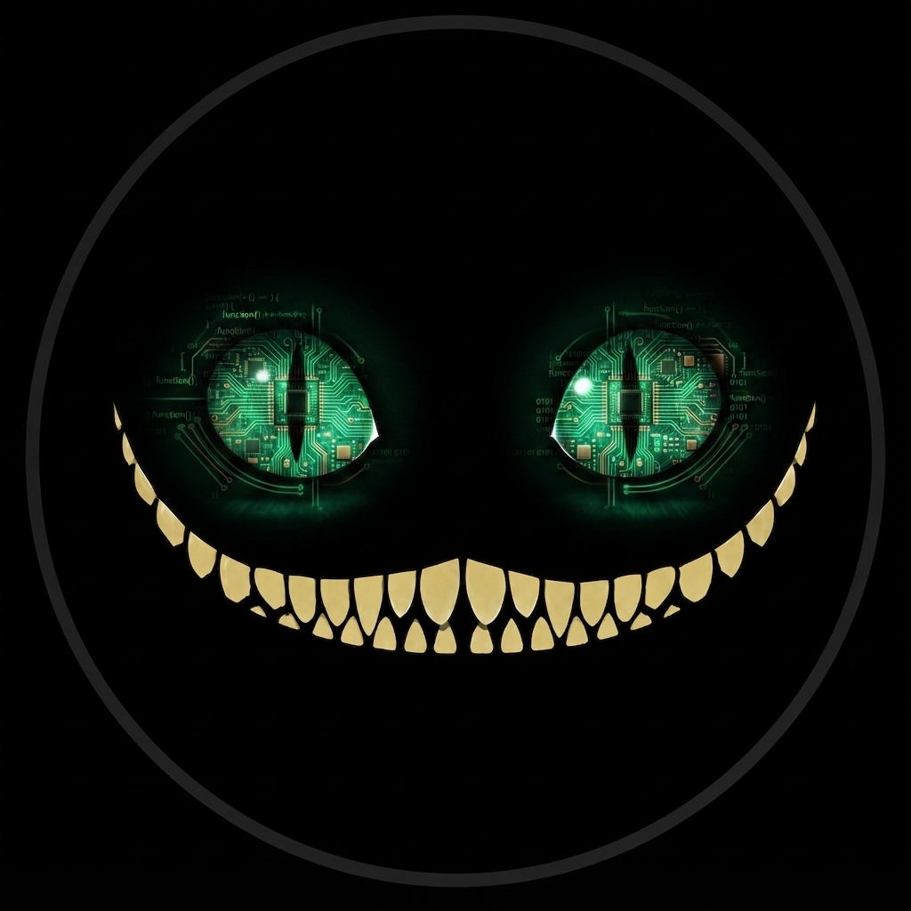

# Dxrk

{ width="120" align="right" }

**El motor open-source de automatización y generación multimedia para agentes de IA: 14 agentes, memoria local-first, SDD, MCP y Dxrk Omni.**

**Dxrk** combina un orquestador de ecosistemas para agentes de IA con un pipeline multimedia que convierte un tema en un short vertical o en una producción long-form por capítulos. Python 3.14+, 100% de cobertura y CI verde en Linux, macOS y Windows.

- 🐍 **Python 3.14+** con TUI moderna basada en [Textual](https://textual.textualize.io/)
- 🤖 Configura **14 agentes** con un solo comando
- 🧠 **DxrkMemory 2.0** — memoria local con SQLite FTS5 + BM25, grafo temporal, AAAK y layers, sin `chromadb` ni `onnx`
- 🎬 **Dxrk Omni** — guion, imágenes, narración, subtítulos word-level, música y montaje FFmpeg en un solo pipeline
- 🖼️ **Backends visuales** — ComfyUI local, SD WebUI, imágenes propias y placeholders con fallback automático
- 🔊 **Audio y música** — Edge-TTS, Whisper, FFmpeg synth, MusicGen y Stable Audio
- 🔄 Conmutador de proveedores y modelos con asignación por fase vía `dxrk-py model` (`list`/`current`/`set`)
- 🛠️ Workflows de desarrollo completos (Git, commit, review, PR)

## Instalación

```bash
uv tool install git+https://github.com/Dxrk777/Dxrk.git
```

Desde el código fuente:

```bash
git clone https://github.com/Dxrk777/Dxrk.git
cd Dxrk
uv sync --all-extras --dev
```

## Uso rápido

```bash
# Instala y configura un agente con el preset completo
dxrk-py install --agent claude-code --preset full-dxrk

# Consulta tu base de conocimiento
python -m dxrk.memory search "configuro mi stack"

# Sincroniza tu configuracion (vista previa)
dxrk-py sync --agent claude-code --dry-run
```

## Dxrk Omni

```bash
# Short vertical: 1080x1920, 30 fps, H.264/AAC
uv run python scripts/omni.py "el futuro de la IA en Tokio"

# Long-form por capítulos
uv run python scripts/omni.py "el futuro de la IA en Tokio" \
  --longform --chapters 3 --shots-per-chapter 3 --chapter-duration 60
```

Requisitos: Python 3.14+, `ffmpeg`/`ffprobe` en `PATH` y el extra `omni` (`uv sync --extra omni`). La guía completa está en [Dxrk Omni](omni.md) y la referencia de flags en [`scripts/README.md`](https://github.com/Dxrk777/Dxrk/blob/main/scripts/README.md).

## Documentación

- [Dxrk Omni](omni.md)
- [Uso](usage.md)
- [Uso previsto](intended-usage.md)
- [Agentes soportados](agents.md)
- [Componentes](components.md)
- [Arquitectura](architecture.md)
- [DxrkMemory 2.0](memory.md)
- [Plataformas](platforms.md)
- [Configuración](config.md)

## Licencia

MIT — consulta [LICENSE](https://github.com/Dxrk777/Dxrk/blob/main/LICENSE).
